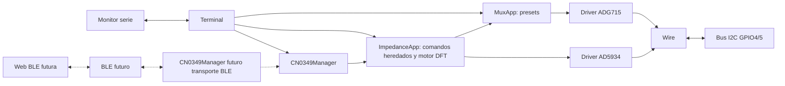
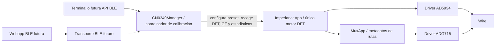
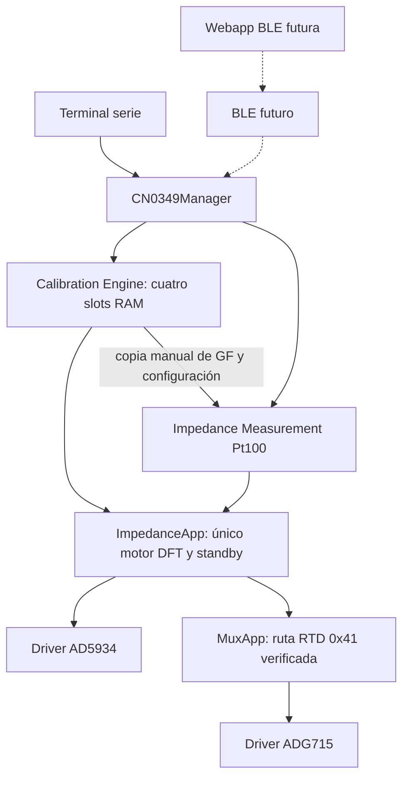
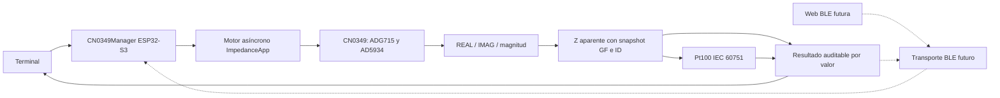
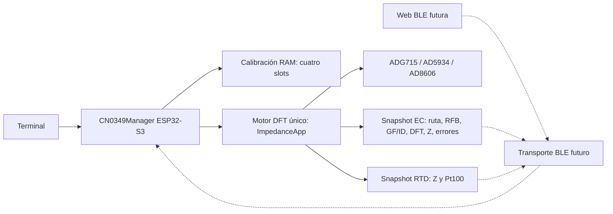

# Arquitectura ATLANTES CN-0349

## Estado implementado: Hitos 1A–2A

`main.cpp` inicializa Serial y Wire (GPIO4/5, 100 kHz, timeout 25 ms), crea una
instancia única de cada driver y entrega sus referencias a las aplicaciones.
El bucle cooperativo actualiza el terminal, la aplicación de impedancia y el
control de multiplexor; no crea instancias paralelas de Wire ni de los IC.

`Terminal` ofrece una tabla base y tres módulos estáticos: `ImpedanceApp`,
`MuxApp` y `CN0349Manager`. Durante una adquisición, MuxApp y el escáner respetan el indicador de
ocupación. `measure status`, `result`, `stop`, `help` y `config` siguen disponibles.

`lib/AD5934` implementa protocolo y operaciones acotadas para configuración,
control y lectura DFT, incluido Increment Frequency. No conoce el ADG715 ni el terminal. `lib/ADG715` implementa
el registro de switches sin política CN0349. `src/mux/MuxApp` aplica presets
permitidos e interlock de estado AD5934. `src/impedance/ImpedanceApp` coordina
ambos drivers en una máquina de estados no bloqueante para obtener un único punto.
Tras configurar Range/PGA en power-down, cambia explícitamente a standby antes
de programar el barrido y emitir Initialize, siguiendo la Figura 24.

Hito 1E añade estado consultable y errores tipados a ImpedanceApp. ACK, lectura
de registros, configuración verificada, estado operativo y diagnóstico completo
se mantienen como indicadores distintos. `ad5934 diag` es no destructivo;
`recover` no cambia la máscara del ADG715, verifica standby y conserva el
historial. La aplicación bloquea adquisiciones si el estado no está verificado.
Los comandos siguen delegados al mismo módulo, sin lógica de hardware en Terminal.

El perfil 1D.1b requiere MCLK externo 1 MHz provisto por el oscilador CN-0349,
usa 2 kHz, Range 1 y PGA ×1, cero incrementos y 10 settling cycles. El preset de
calibración por defecto es CAL_LOW_1K (`0x12`); ImpedanceApp guarda un identificador
y MuxApp resuelve sus metadatos/máscara a través de su API pública. La selección
lógica no conmuta hardware hasta iniciar la adquisición. La app espera a D1 antes
de leer REAL/IMAG, captura el preset aplicado en el resultado y termina en standby.
1D.2 añade barrido de máximo 64 puntos en la misma máquina de estados, con arreglo
estático, fase DFT y conservación de resultados parciales. No calcula
impedancia/conductividad ni calibración. El firmware no puede comprobar el
oscilador por I²C.

## Componentes y evolución

Hito 2A añade `CN0349Manager` como API de alto nivel. Conserva una referencia al
`ImpedanceApp` existente y no crea driver ni máquina DFT. El Manager comparte su
`update()` con el loop principal; los comandos `cn0349` invocan su API, que delega
configuración, start/cancel, diagnóstico y resultados a ImpedanceApp. Los
comandos anteriores `ad5934`/`adg715` se mantienen. Configuración y máscara
observada se consultan desde las capas existentes para sincronizar cambios hechos
por esos comandos. `getStatus()` y `getDiagnostics()` son snapshots sin I²C;
`runDiagnostics()` es la operación activa separada.

| Componente | Función | Estado |
| --- | --- | --- |
| `include/` | Configuración y funciones matemáticas puras | Implementado |
| `src/main.cpp` | Arranque y ciclo cooperativo | Implementado |
| `src/terminal/` | Terminal, escaneo y dispatch estático de tres módulos | Implementado |
| `lib/AD5934/` | Registros y control protegido del AD5934 | 1B, 1D.1 y 1D.2 |
| `src/impedance/` | Estado, errores, diagnóstico, recovery y adquisiciones DFT | 1B a 1E |
| `lib/ADG715/` | Protocolo genérico ADG715 | 1C |
| `src/mux/` | Presets CN0349, interlock y metadatos de calibración | 1C y 1D.1b |
| `src/cn0349/` | API de alto nivel sobre ImpedanceApp | 2A |
| BLE | Transporte de comandos/resultados | Futuro |
| Aplicación web BLE | Interfaz y visualización | Futuro |

El Manager implementado prepara la API que usarán BLE y la web futura. La web
hablará con el ESP32-S3 por BLE; ni BLE ni la web se implementan en 2A.

## Flujo de datos

Las transacciones Wire son síncronas y están acotadas por timeout; cada tick de
la máquina hace como máximo una fase de aplicación, pero una llamada individual
de lectura/escritura puede realizar más de una transacción breve. No es un mutex
frente a otro maestro ni una garantía de tiempo real estricto. La app usa polling
cada 5 ms y timeout DFT de 500 ms, y recupera a standby en errores cuando el bus
lo permite. Hito 1E añade límite de 1500 ms a las fases de control/configuración.
Los comandos diag/recover hacen varias transacciones síncronas en su handler; cada
transacción se limita por Wire a 25 ms, por lo que la respuesta completa puede
ocupar más de un tick del loop. No existe arbitraje multi-maestro.

## Hito 2B — calibración electrónica

`CN0349Manager` coordina la calibración, pero `ImpedanceApp` continúa siendo el único motor DFT y `MuxApp` conserva la tabla única de presets y metadatos RFB/RCAL. Cada paso configura un preset y solicita una adquisición single existente. El `update()` cooperativo recoge el resultado DFT y programa la siguiente muestra; no crea un motor de conversión paralelo ni accede directamente a registros I2C.

El Manager guarda una calibración en RAM por preset, con cinco muestras individuales y estadística agregada. La sustitución de cada slot ocurre únicamente al completar una serie válida. `cal run all` recorre los cuatro IDs existentes en orden. Consultas no realizan I2C. Diagnóstico y recuperación siguen usando las acciones explícitas de ImpedanceApp.

BLE y webapp siguen siendo futuras capas de transporte/presentación. La calibración 2B no mide una celda externa y no valida la precisión de impedancia. Consultar [`src/cn0349/README.md`](../src/cn0349/README.md) para el modelo e hipótesis, y [`test/hito2b.md`](../test/hito2b.md) para el procedimiento físico.

## Hito 2C.1 — Impedance Measurement

El firmware conserva las instancias únicas de main.cpp. Dentro del Manager,
Calibration Engine (2B) y la nueva coordinación de Impedance Measurement se
excluyen mediante busy y comparten ImpedanceApp. La medida toma una copia de
un slot de calibración HIGH; nunca modifica los slots. ImpedanceApp selecciona
RTD con MuxApp y ejecuta su máquina DFT única. Los drivers permanecen genéricos.

El terminal solo transporta solicitudes y presenta snapshots. BLE y la webapp
futuras consumirán la API pública de medida sin acceso a drivers. No se implementan
en este hito. COMPLETE significa adquisición y standby verificados más cálculo
finito; FAILED/CANCELLED preservan el resultado válido anterior por separado.
Los rechazos previos tienen un código de solicitud separado del estado del intento.

Start incluye preflight I²C síncrono acotado heredado (timeout 25 ms por
transacción); conversión, polling y finalización progresan cooperativamente,
sin bucles de espera nuevos. El fallo de comunicación puede impedir standby;
se informa FAILED, nunca éxito supuesto. [Circuito y modelo](pt100-route.md),
[API](../src/cn0349/README.md), [validación](../test/hito2c1.md).

## Hito 2D — temperatura experimental, 2026-10-27

La cadena ESP32-S3 → CN0349 (ADG715/AD5934) → adquisición DFT → impedancia
aparente añade procesamiento Pt100 IEC 60751. El módulo matemático es puro;
CN0349Manager conserva el resultado de adquisición y su calibración junto a
la conversión. La futura web BLE recibirá este snapshot auditable y los errores
separados; no deberá recalcular resultados antiguos con la selección actual.

`EXPERIMENTAL / NOT ABSOLUTELY CALIBRATED`: no se modifica GF, no se transforma
fase en resistencia ni se compensa cable. Tres hilos conectados como dos
terminales añaden resistencia de cables y contactos. El campo reservado
`cableCompensationApplied` permanece false; una política futura deberá preservar
siempre la impedancia original. BLE/web siguen sin implementarse.
[Ecuaciones e inversión](../src/temperature/README.md),
[interfaces](../src/cn0349/README.md), [validación](../test/hito2d.md).

## Preparación al encender — 2026-10-27

`setup` inicia bus/drivers y solicita al Manager `prepareMeasurements()`.
La secuencia por defecto es recover → calibración de cuatro presets a 2000 Hz
→ comprobación de compatibilidad → anuncio de sistema preparado. Las muestras
se adquieren cooperativamente desde el loop existente. Terminal y futura BLE
deben respetar busy hasta terminar. Un fallo o cancelación se comunica como
preparación incompleta, conservando diagnóstico y comandos manuales disponibles.
Se mantienen selección RTD y snapshots; los coeficientes son nuevos en cada
arranque y residen en RAM. Esta preparación no valida exactitud absoluta.

## Adquisición periódica de temperatura — 2026-10-27

El Manager añade `temperature continuous`, un planificador cooperativo de
1000 ms que reutiliza exactamente la misma adquisición y conversión. Reserva
el subsistema entre muestras, publica cada resultado en el terminal y mantiene
el último snapshot para consulta. `temperature stop` libera la reserva y, si
procede, cancela con standby. Un resultado inválido detiene la secuencia. No hay
un segundo motor DFT ni recalibración por muestra. La futura interfaz BLE puede
usar `startContinuousTemperature`, `isContinuousTemperature` y los snapshots.

## Hito 2E.1 — adquisición EC, 2026-10-27

El firmware ESP32-S3 conserva `setup` con recover y calibración RAM de cuatro
slots. Terminal → CN0349Manager → ImpedanceApp → ADG715/AD5934 sigue siendo
la única cadena de adquisición. El Manager añade un estado EC HIGH (`0x81`,
RFB 100 ohm) o LOW (`0x82`, RFB 1 kohm), selección de calibración por RFB,
snapshot y errores propios. `ImpedanceApp` realiza preflight, readback de ruta,
DFT y standby. Manager aplica el GF del slot congelado y conserva REAL/IMAG,
magnitud, fases, frecuencia, máscara, RFB, ID y Z aparente. RTD/temperatura
mantienen sus resultados separados. Ninguna capa interpreta Z como
conductividad; el modelo R2 sigue pendiente de verificación y análisis.

El futuro transporte BLE podrá exportar snapshots y errores sin recalcular
medidas antiguas con una selección nueva. No se implementa BLE ni conversión
EC→conductividad en este hito. [Topología EC](ec-route.md),
[API](../src/cn0349/README.md), [ensayo](../test/hito2e1.md).

## Hitos 2E.2 y 2E.3 — Sonda real y estimación de conductividad

La sonda EC se conecta a J1 Yx-1/Yx-2. La cadena es sonda → ADG715/AD5934 →
`ImpedanceApp` → snapshot EC del `CN0349Manager` → módulo puro
`Conductivity::convert` → resultado experimental → terminal y futura WebApp
BLE. `cn0349 conductivity start` llama al mismo `startEc` no bloqueante; no
crea otro driver ni máquina DFT. La ruta HIGH/LOW y una calibración con el mismo
RFB se seleccionan de forma explícita. Cada solicitud congela máscara, RFB,
ID/GF y parámetros DFT; solo se calcula tras un resultado EC completo, válido
y con standby verificado. Un rechazo de preflight conserva el resultado previo.

El modelo disponible es RAW: `Rcelda_estimada = Zaparente` y
`EC_estimada = 10⁶ × K_nominal / Rcelda_estimada` en µS/cm, con K nominal de
1 cm⁻¹. Se usa la magnitud de impedancia como aproximación resistiva;
`|Z|` puede diferir de `Re(Z)`. El resultado conserva la impedancia original,
REAL/IMAG, fase y toda la configuración de la adquisición. La electrónica EC
incluye R2 nominal de 100 Ω, pero `SERIES_R2_EXPERIMENTAL` permanece
**deshabilitado** hasta verificar su contribución equivalente en la placa; no
hay sustracción automática, compensación térmica, calibración con patrones,
autorange ni barrido nuevo.

La futura WebApp BLE podrá presentar los snapshots sin recalcularlos con el
preset actual. Identidad de muestra, fecha/sesión y temperatura externa son
metadatos experimentales que hoy se registran en Markdown. BLE y persistencia
siguen sin implementar. El hito 2E.4 queda reservado para patrones,
constante de celda efectiva y validación metrológica.
[Protocolo de sonda](../test/hito2e2.md),
[módulo de conversión](../src/conductivity/README.md).
