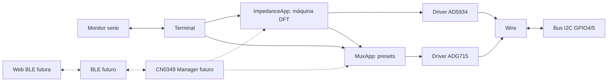

# Arquitectura ATLANTES CN-0349

## Estado implementado: Hitos 1A–1E

`main.cpp` inicializa Serial y Wire (GPIO4/5, 100 kHz, timeout 25 ms), crea una
instancia única de cada driver y entrega sus referencias a las aplicaciones.
El bucle cooperativo actualiza el terminal, la aplicación de impedancia y el
control de multiplexor; no crea instancias paralelas de Wire ni de los IC.

`Terminal` ofrece una tabla base y hasta dos módulos estáticos: `ImpedanceApp` y
`MuxApp`. Durante una adquisición, MuxApp y el escáner respetan el indicador de
ocupación. `measure status`, `result`, `stop`, `help` y `config` siguen disponibles.

`lib/AD5934` implementa protocolo y operaciones acotadas para configuración,
control y lectura DFT, incluido Increment Frequency. No conoce el ADG715 ni el terminal. `lib/ADG715` implementa
el registro de switches sin política CN0349. `src/mux/MuxApp` aplica presets
permitidos e interlock de estado AD5934. `src/impedance/ImpedanceApp` coordina
ambos drivers en una máquina de estados no bloqueante para obtener un único punto.
Tras configurar Range/PGA en power-down, cambia explícitamente a standby antes
de programar el barrido y emitir Initialize, siguiendo la Figura 24.

Hito 1E añade estado consultable y errores tipados a ImpedanceApp. ACK, lectura
de registros, configuración verificada, estado operativo y diagnóstico completo
se mantienen como indicadores distintos. `ad5934 diag` es no destructivo;
`recover` no cambia la máscara del ADG715, verifica standby y conserva el
historial. La aplicación bloquea adquisiciones si el estado no está verificado.
Los comandos siguen delegados al mismo módulo, sin lógica de hardware en Terminal.

El perfil 1D.1b requiere MCLK externo 1 MHz provisto por el oscilador CN-0349,
usa 2 kHz, Range 1 y PGA ×1, cero incrementos y 10 settling cycles. El preset de
calibración por defecto es CAL_LOW_1K (`0x12`); ImpedanceApp guarda un identificador
y MuxApp resuelve sus metadatos/máscara a través de su API pública. La selección
lógica no conmuta hardware hasta iniciar la adquisición. La app espera a D1 antes
de leer REAL/IMAG, captura el preset aplicado en el resultado y termina en standby.
1D.2 añade barrido de máximo 64 puntos en la misma máquina de estados, con arreglo
estático, fase DFT y conservación de resultados parciales. No calcula
impedancia/conductividad ni calibración. El firmware no puede comprobar el
oscilador por I²C.

## Componentes y evolución

| Componente | Función | Estado |
| --- | --- | --- |
| `include/` | Configuración y funciones matemáticas puras | Implementado |
| `src/main.cpp` | Arranque y ciclo cooperativo | Implementado |
| `src/terminal/` | Terminal, escaneo y dispatch fijo | Implementado |
| `lib/AD5934/` | Registros y control protegido del AD5934 | 1B, 1D.1 y 1D.2 |
| `src/impedance/` | Estado, errores, diagnóstico, recovery y adquisiciones DFT | 1B a 1E |
| `lib/ADG715/` | Protocolo genérico ADG715 | 1C |
| `src/mux/` | Presets CN0349, interlock y metadatos de calibración | 1C y 1D.1b |
| `src/cn0349/` | CN0349 Manager | Futuro |
| BLE | Transporte de comandos/resultados | Futuro |
| Aplicación web BLE | Interfaz y visualización | Futuro |

El Manager futuro podrá centralizar la política de rutas y adquisiciones para
terminal y BLE. La web futura hablará con el ESP32-S3 por BLE; ni el Manager,
BLE ni la web se implementan en 1D.2.

## Flujo de datos

Las transacciones Wire son síncronas y están acotadas por timeout; cada tick de
la máquina hace como máximo una fase de aplicación, pero una llamada individual
de lectura/escritura puede realizar más de una transacción breve. No es un mutex
frente a otro maestro ni una garantía de tiempo real estricto. La app usa polling
cada 5 ms y timeout DFT de 500 ms, y recupera a standby en errores cuando el bus
lo permite. Hito 1E añade límite de 1500 ms a las fases de control/configuración.
Los comandos diag/recover hacen varias transacciones síncronas en su handler; cada
transacción se limita por Wire a 25 ms, por lo que la respuesta completa puede
ocupar más de un tick del loop. No existe arbitraje multi-maestro.
